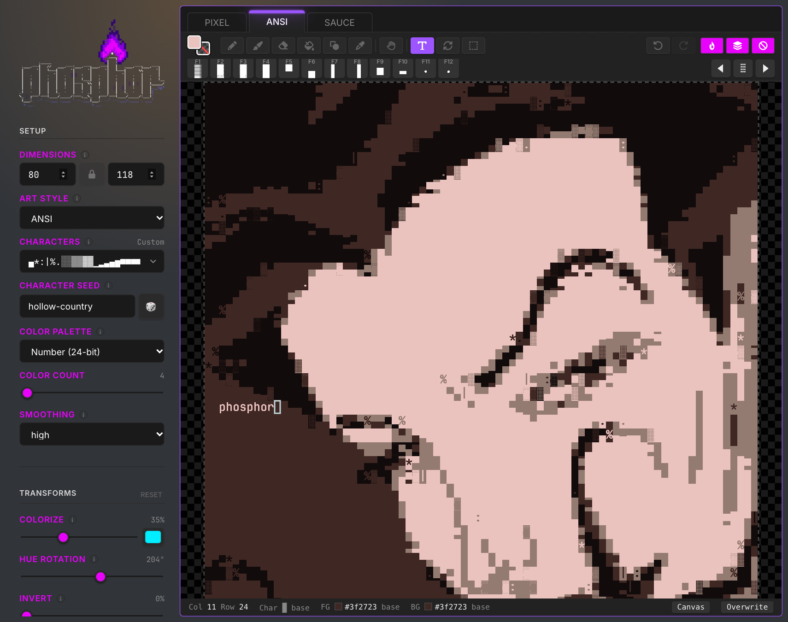

Phosphor
========

The app / a live demo is available at [phosphor.work](https://phosphor.work).

Make ANSI art in the browser. Start from an image (or a blank canvas): Phosphor converts it to
character cells, and you tune the conversion with image adjustments, effects, palettes and the
characters it draws with. Then draw on top of it: paint, type, select and move, shape and fill, and
merge your drawing into the picture so the effects apply to it too. Save the project to keep working
on it, or export a standard `.ans` or a modern `.utf8ans` file, both with embedded
[SAUCE](https://www.acid.org/info/sauce/sauce.htm) metadata.

[](https://phosphor.work)

## Features

**Converting an image**

- **Adjustments and effects**: brightness, contrast, saturation, hue rotation, colorize, invert,
  flatten, sharpen and edges, all live. Every slider move is an undo step, and **Bake** turns the
  picture as it looks into the image so you can start another round on top.
- **Palettes**: full 24-bit color, CGA (16), VGA (256), a number of colors picked from the picture
  and your drawing, or your own list of colors.
- **Characters**: ready-made sets (shades, blocks, half blocks, quadrants, CP437-only, ASCII ramps)
  or your own, placed by a seedable random generator for texture, or by brightness in the ASCII
  styles.
- **Art styles**: ANSI (colored blocks and characters), Color ASCII and Monochrome ASCII.

**Drawing**

- **Two layers**: the base layer (your image, converted) and the edit layer (everything you draw).
  Merge your drawing down into the base, exactly as it is or into the image itself so effects like
  Edges outline it; or merge the base up to edit it as cells.
- **Tools**: Pencil, Brush, Paint Bucket, Shapes (boxes in line characters, half blocks, any
  character), Eraser, Flip, Color Picker and Hand.
- **Edit Mode**: type straight into the art, with the character palettes on the F-keys, insert and
  overwrite, and any script a terminal can show, including two-column characters (Chinese,
  Japanese, Korean, emoji), laid out the way a terminal lays them out.
- **Select**: copy, cut, paste (also as text to and from other apps), and move a selection, which
  floats over the art until you set it down.
- **Undo** for everything, and **keyboard shortcuts** for the rest: press **?** in the app for the
  list (holding Alt picks a color while you draw, holding Space pans).

**Saving**

- **Projects** (`.phosphor`): the image, both layers and every setting, to open again later.
- **Exports**: `.ans` (CP437, for classic viewers; the export lists any characters CP437 can't hold
  and what they become) and `.utf8ans` (UTF-8, for modern terminals; every character kept). Any
  palette works with either format.
- **SAUCE metadata**: title, author, group, date, font name, iCE colors.
- **Memory**: settings persist across sessions via localStorage, and can be reset.

How the layers, merging, baking and tools work: [docs/layers.md](docs/layers.md). Characters,
typing and the two file formats: [docs/characters.md](docs/characters.md).

## How it works

The image is drawn onto a canvas at `cols × (rows × 2)` pixels and run through the adjustments and
effects on the GPU. Each pair of vertically adjacent pixels becomes one character cell: the top pixel
its background color, the bottom pixel its foreground color, drawn with `▄` (U+2584 LOWER HALF
BLOCK) or one of the characters from the set, which doubles the effective vertical resolution. A
palette, when one is chosen, snaps every color to its nearest entry.

What you draw sits on top of that: the base layer's own pixels (edits to the picture itself), then
the edit layer's paint and typed cells. The ANSI view shows the result cell for cell, and an export
writes exactly those cells: a stream of ANSI escape sequences followed by a 128-byte SAUCE record.

## Output formats

| Format     | Color                                        | Characters | Newlines          |
|------------|----------------------------------------------|------------|-------------------|
| `.ans`     | Legacy CGA SGR or Xterm-256 / TrueColor      | CP437      | none (raw stream) |
| `.utf8ans` | 24-bit `ESC[38;2;R;G;Bm` / `ESC[48;2;R;G;Bm` | UTF-8      | `\r\n` per row    |

## Compatibility Note

While Phosphor allows you to export high-color data (VGA 256 or 24-bit TrueColor) into standard `.ans` files, most legacy ANSI viewers and editors only support the basic 16-color CGA palette.

For proper viewing and editing of advanced color `.ans` files, check out the **[Advanced Color fork of the Moebius editor](https://github.com/christiansacks/moebius)**.

## Development Setup & Usage

### Prerequisites
- **Node.js**: Version 22.12+
- **npm**: Version 9+

### Commands
```bash
npm install       # Install dependencies
npm run dev       # Start dev server at http://localhost:5173
npm run build     # Create production build in dist/
npm run preview   # Preview the production build locally
npm run lint      # Run ESLint
npm test          # Lint and every test layer (run `npx playwright install --with-deps chromium` once first)
npm run test:unit     # Pure logic, in Node
npm run test:browser  # The store, canvas and WebGL, in Chromium
npm run test:e2e      # Real interactions against a production build
npm run test:update   # Rewrite reference files (read the diff before committing)
```

Tests run on every pull request and gate the GitHub Pages deploy. See [docs/testing.md](docs/testing.md)
for which layer a new test belongs in, and [AGENTS.md](AGENTS.md) for where things live in the code
and the rules of the road.

Every build is stamped with its version and the commit it was built from. The version is
`package.json`'s major.minor with the day it was built as the third number (`v0.1.20261024`); the
commit tells two builds on one day apart. The About box shows both, and so does the page's
`<meta name="phosphor-build">` (so `curl -s <site> | grep phosphor-build` says what's deployed). A build
from uncommitted changes says `-dirty` after the commit.

## Credits

ANSI art preview and rendering was initially powered by the [play](https://github.com/ertdfgcvb/play.core) creative-coding runtime by [ertdfgcvb](https://ertdfgcvb.xyz/), but it's since been adapted into a minimal subset of the functionality. I wanted to credit that work as the initial inspiration for the project, and suggest checking it out as something that's pretty awesome in its own right.

## License

Phosphor is released under the MIT license:

* https://opensource.org/licenses/MIT

Copyright 2026 [jejacks0n](https://github.com/jejacks0n)

## Make Code Not War