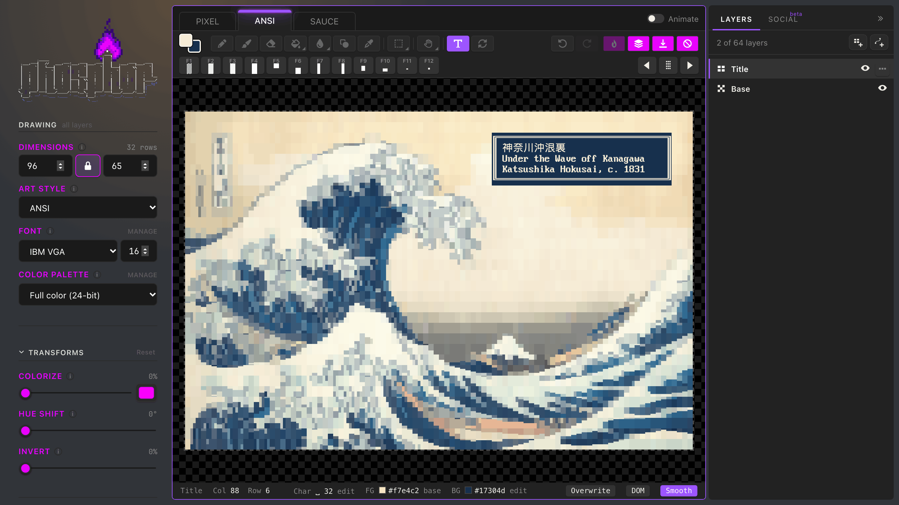
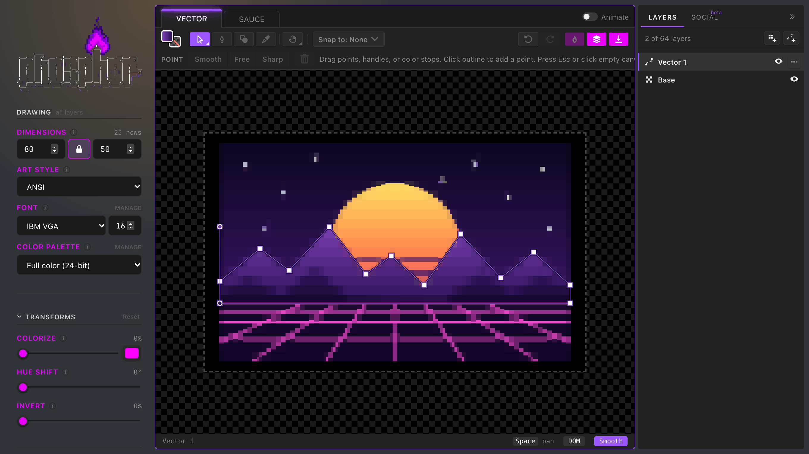
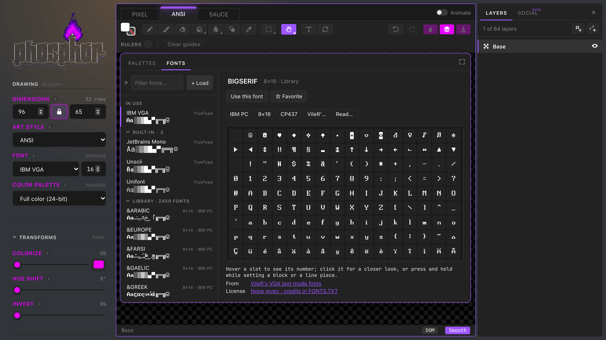
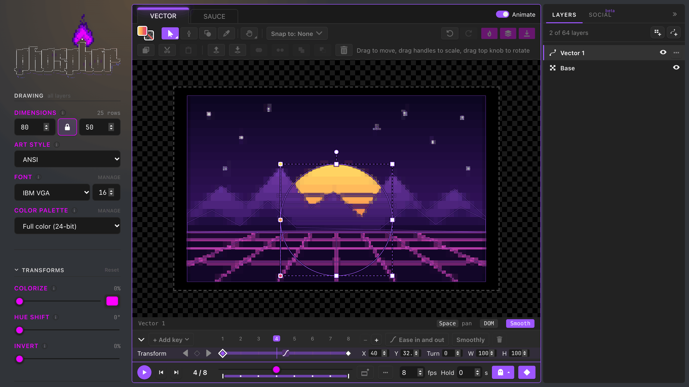

# Phosphor

Phosphor is an ANSI and ASCII art editor that runs in your browser. It turns pictures into text art and opens art files you already have. You can paint, type, draw shapes, stack layers, animate, and draw with other people. When you finish, you can export files for terminals, BBSes, and websites.

Try the latest version at [next.phosphor.work](https://next.phosphor.work), where every update lands first. Stable releases go to [phosphor.work](https://phosphor.work), and the [desktop app](docs/desktop.md) for macOS, Windows, and Linux is on the [Releases page](https://github.com/jejacks0n/phosphor/releases).

[](https://phosphor.work)

## What it does

### Turn a picture into text art

Load a picture, and Phosphor turns it into a grid of character cells. You can choose from three art styles: ANSI, Color ASCII, or Monochrome ASCII. Pick which characters to use from presets (like Blocks & shades, Half-blocks, and Quadrants) or type your own set. Then pick how Phosphor chooses each character: at random from a seed, by brightness, by the closest match of character and colors, or by the shape inside each cell.

You can keep full 24-bit colors or limit them to a palette. Phosphor supports CGA (16 colors), VGA (256 colors), a set number of colors picked from your picture, or your own color list. Dithering (Floyd–Steinberg or ordered) blends colors smoothly between palette steps.

Image sliders update your art live as you move them. You can adjust colorize, hue shift, invert, brightness, contrast, levels, saturation, posterize, threshold, blur, simplify, sharpen, and edges. Every slider move is its own undo step. **Bake** saves your slider changes into the picture and resets the sliders for another round. **Flatten** turns the whole drawing into plain cells so you can edit it as ANSI.

You can also start from a blank canvas.

### Open art you already have

Phosphor opens `.ans`, `.utf8ans`, `.xb`, `.bin`, `.asc`, `.txt`, `.nfo`, and `.diz` files just as they look. Any SAUCE record in the file fills the SAUCE tab. Phosphor asks how you want to open the art: on a layer to edit, as the base to draw over, or as a picture to convert again. If you drop a file onto an open drawing, you can add it to that drawing instead. An `.svg` file opens as shapes you can keep editing. See [Opening ANSI and text files](docs/layers.md#opening-ansi-and-text-files) for what opens and any limits.

### Draw and type

Two views show the same cells in different ways. **ANSI** edits characters and their two colors, while **PIXEL** paints the half-cell pixels inside them. Most tools work in both views: Pencil, Brush, Eraser, Paint Bucket, Gradient, Shapes (rectangles, ellipses, and lines in blocks or connected box-drawing lines), Blur, Dodge, Burn, and Eyedropper. Select and Magic Wand let you cut, copy, paste, move, flip, rotate, and recolor blocks of cells. Paste works with blocks copied from another Phosphor tab or Moebius, and with plain text from anywhere else.

Typing works like a terminal. Chinese, Japanese, and Korean characters and emoji take two columns, and your system input methods work just like in any text box. Overwrite, Insert, and Partial modes control how typing pushes other characters aside. Press F1 to F12 to type from a palette of twelve characters (such as box drawing, blocks, shades, and arrows). You can switch palettes or make your own. Any character not in CP437 still saves in `.utf8ans` files.

### Layers

A new drawing starts with one base layer (the converted picture), and tools draw directly on it. Add drawing layers to keep new work separate, and add vector layers for shapes, up to 64 layers total. You can hide, rename, move, and duplicate any layer, and give each layer its own character settings. **Merge down** combines a layer into the one below it. Read the [layer guide](docs/layers.md) for all the details.

### Vector shapes

[](docs/vector.md)

On the VECTOR tab, draw shapes over your art using the Pen, Node, and Shape tools. Add fills, outlines, and gradients, and join, add, or subtract shapes. Because shapes stay editable, you can move, scale, rotate, and reshape them at any time. Phosphor turns them into characters as you work, with finer detail than paint tools reach. An `.svg` file opens as shapes too. An art layer holds a group of hand-drawn cells inside your vector layer so you can move and animate it as one piece. See the [vector guide](docs/vector.md).

### Fonts

[](docs/characters.md#the-font)

Phosphor draws your art with one of four built-in fonts: IBM VGA, JetBrains Mono, Unscii, and GNU Unifont. You can also load your own monospaced TrueType, OpenType, or WOFF font, or a bitmap font (`.F01` to `.F32`, or a PNG sheet of its 256 characters), just like old DOS art. The Fonts page also has a library of more than 2,400 bitmap fonts from VileR's VGA text mode fonts and the Mœbius XBin fonts for the IBM PC, its clones, the Amiga, and more. A bitmap font belongs to your drawing: it saves inside the project file and `.xb` exports, and opening an `.xb` file loads its font too. See [The font](docs/characters.md#the-font) for more.

### Colors and palettes

Under the color pair, a box holds a color picker and a **Palettes** page. On the Palettes page, you can edit your drawing's own color list, browse a built-in library of palettes from Lospec, view your favorites, or fetch any Lospec palette by its name or link. You can import and export color lists as `.hex` files. A 16-color drawing has [iCE colors](docs/characters.md#ice-colors) for bright backgrounds, or blinking backgrounds like on DOS.

### Animation

[](docs/animation.md)

Turn on **Animate** to turn your drawing into a movie with a row of frames. Draw each frame with the same tools, all played over the same base layer. A new frame can be Blank (art from earlier frames stays visible, and fixes to earlier frames update later ones), a Duplicate of the current frame, or a Wipe that starts clean. The ghost dims nearby frames so you can line up your next drawing. Each frame can hold for its own length of time, playback loops, and undo works across frames. On VECTOR, tweens smoothly move, scale, rotate, and recolor shapes between keys with your choice of easing, and shapes can follow a path. See the [animation guide](docs/animation.md).

### Drawing together

**SOCIAL** (in beta) lets you use rooms to draw with others. Host a room so people can watch you draw live and chat, or invite up to seven people to draw together at the same time. Browsers connect directly to the host's browser. You can create an account or join as a guest. See [Social rooms](docs/social.md).

### The desktop app

Phosphor also comes as a desktop app for macOS, Windows, and Linux on the [Releases page](https://github.com/jejacks0n/phosphor/releases). Drawing works the same way as in the browser. Rooms in the desktop app need no account and no server: you host a room on your computer and give people its address. You can double-click a `.pho` file to open it and save straight back to that file. See [The desktop app](docs/desktop.md).

### Plugins

A plugin adds color themes, a script, or both. Scripts can add new ways to pick characters (solvers), new brushes, new shapes for the Shape tool, and new picture filters. The **Marketplace** in the Plugins dialog lists available plugins, including Phosphor's own: Midnight and Rain (themes), Outlines (solver), Smear (brush), Superformula (shape), and Aberration (filter). A plugin's script only runs after you choose to install it. See [Plugins](docs/plugins.md) to learn how to install plugins or write your own.

### More features

- Press **?** for keyboard shortcuts, and press **Cmd+K** (Ctrl+K on Windows and Linux) to search for any command by name.
- [Rulers and guides](docs/rulers.md) measure your art in columns and rows.
- Switch between dark, light, and system themes, in English or French.
- Phosphor works on a phone, where the settings and side panel slide in from the sides.
- Your work saves automatically in your browser as you go. Reloading brings it back, the start screen lists your last five drawings, and **Versions** keeps snapshots you can return to ([Automatic browser backups](docs/characters.md#automatic-browser-backups)).

Read the [guides](docs/README.md) to learn about everything Phosphor offers.

## Files

### What opens

| Kind | Types |
|---|---|
| Pictures | PNG, JPEG, GIF, WebP, BMP, and AVIF |
| Projects | `.pho`, and the older `.phosphor` |
| ANSI and text art | `.ans`, `.utf8ans`, `.xb` (XBin), `.bin` (BinaryText), `.asc`, `.txt`, `.nfo`, and `.diz` |
| Vector art | `.svg` |
| Fonts | `.F01` to `.F32`, a PNG sheet of 256 characters, `.ttf`, `.otf`, `.woff`, and `.woff2` |
| Color palettes | `.hex` and `.txt` |
| Character palettes | `.palettes.json` |
| Plugins | A folder, a `.zip` of a folder, or its `phosphor-plugin.json` |

A drawing can be up to 300 columns, 5,000 lines, and 500,000 cells.

### The project file

**Save project** writes a `.pho` file that keeps your whole project: the picture, every layer, frames, shapes, settings, SAUCE record, and the drawing's bitmap font. Older `.phosphor` files still open too.

A `.pho` file is also a real PNG image with your project stored inside it:

- **Previews**: Any image viewer shows the picture, with no Phosphor needed.
- **Thumbnails**: With the desktop app installed, your file manager shows the drawing as the file's thumbnail. This works in Finder icons and Quick Look on macOS, Explorer on Windows (when chosen in the installer), and file managers on Linux (the `.deb` package installs a thumbnailer).
- **In a terminal**: Running `cat filename.pho` prints the drawing in color, just like a `.utf8ans` export, and returns your terminal to normal afterward. This is tested in Ghostty and macOS Terminal. Save sets up the file for this unless you turn off **Show the drawing when printed in a terminal** in the Save dialog.

See [The .pho file](docs/pho.md) to learn how the file is laid out.

### What it exports

| File | What it is | Colors | Characters |
|---|---|---|---|
| `.ans` | ANSI for classic viewers and BBSes | 16-color codes for CGA, 256-color codes for VGA, 24-bit codes for the rest | CP437 |
| `.utf8ans` | ANSI for modern terminals | 256-color codes for CGA and VGA, 24-bit codes for the rest | UTF-8 |
| `.txt` | Plain text with no colors or escape codes | None | UTF-8 |
| `.xb` | XBin with the drawing's bitmap font and palette inside | 16 or fewer | The font's 256 |
| `.png` | Picture of the art drawn in its font | All | Drawn in the art's font |
| `.gif` | Looping image of a movie | 256 (one palette for the whole movie) | Drawn in the art's font |
| `.mp4` | Video of a movie, when your browser can encode it | All | Drawn in the art's font |
| Animated `.ans` | ANSiMation that draws frame by frame in a viewer or terminal | Same as `.ans` | CP437 |
| Animated `.utf8ans` | Same as above, for modern terminals | Same as `.utf8ans` | UTF-8 |
| `.cast` | An [asciinema](https://asciinema.org) recording with frame-by-frame timing | Same as `.utf8ans` | UTF-8 |

The last five formats save a whole movie when Animate is on with more than one frame. All other formats save only the frame currently showing.

- **CP437**: An `.ans` file replaces any character outside CP437 with its closest lookalike (or `?`). The Export dialog lists every replaced character before you save. A `.utf8ans` file keeps every character exact.
- **SAUCE**: Still and animated `.ans`, `.utf8ans`, and `.xb` exports end with a [SAUCE](https://www.acid.org/info/sauce/sauce.htm) record. It holds the title, author, group, and comments from the SAUCE tab, plus the date, size, and font. Uncheck **Include SAUCE** in the Export dialog to leave it out.
- **Line breaks**: A `.utf8ans` file ends every row with CR LF, and an `.ans` file does the same when the art is narrower than 80 columns. Animated exports move the cursor instead of scrolling.
- **Speed**: Animated `.ans` and `.utf8ans` files have no clock, so playback speed depends on the viewer. To slow one down in a terminal, try a command like `pv -qL 20000 art.utf8ans`. A `.cast` file keeps exact timing.
- **Bright backgrounds**: With CGA colors, an `.ans` file normally writes bright backgrounds using the DOS blink code. When **iCE colors** is on (the default for new drawings), the file tells viewers to show bright backgrounds instead. It marks this in two places: in the SAUCE record, and with `ESC[?33h` at the top for viewers like SyncTERM. When iCE colors is off, those cells blink just like on DOS.

Many older ANSI viewers only support 16 colors. To view or edit 256-color and 24-bit `.ans` files, try the [Advanced Color fork of Moebius](https://github.com/christiansacks/moebius).

Color lists save as `.hex` files, and character palettes save as `.palettes.json` files.

## How the conversion works

Phosphor shrinks your picture to fit the grid, with two pixels per character cell. The top pixel sets the cell's background color, and the bottom pixel sets its foreground color. With the Pixel character set, every cell uses a half block (`▄`), giving twice as many color rows as text rows. Other character sets place their own characters in the cells. When using a palette, each pixel matches the nearest palette color, or dithering mixes palette colors into a pattern to smooth gradients.

Best match and By shape look even closer at the picture. Best match checks each cell to find the character and two palette colors that come closest to the image. By shape samples each cell on a finer 4 × 8 point grid and picks the character whose shape fits best. This lets quadrants and half-column blocks line up cleanly along edges. See the [character guide](docs/characters.md#how-the-converter-picks-characters) to learn how each method works.

## Setup and development

Phosphor is a Vue 3 and Pinia app built with Vite.

### Requirements
- Node.js 22.12 or newer
- npm 9 or newer

### Commands

```bash
npm install                # Install project packages
npm run dev                # Start the local test server at http://localhost:5173
npm run build              # Build the finished app in the dist/ folder
npm run preview            # Test the finished build locally
npm run lint               # Check code formatting with ESLint
npm test                   # Run all tests (run `npx playwright install --with-deps chromium` once first)
npm run test:unit          # Run fast logic tests in Node
npm run test:browser       # Test canvas, WebGL, and data store in Chromium
npm run test:e2e           # Test user interactions on a real build
npm run test:update        # Update test reference files when changes are expected
npm run test:performance   # Run the benchmarks, which print tables and aren't part of npm test
npm run desktop            # Build and start the desktop app (Electron)
npm run test:e2e:desktop   # Test the desktop app, which isn't part of npm test either
```

Every pull request runs the tests, and a failing test blocks the deploy. Every push to `main` publishes to [next.phosphor.work](https://next.phosphor.work). A version tag releases the desktop app and, for a release or beta tag, publishes to [phosphor.work](https://phosphor.work). Read [docs/testing.md](docs/testing.md) to learn where to add new tests, and read [AGENTS.md](AGENTS.md) for where files live and the project rules.

## Credits

Phosphor's text rendering started with ideas from [play.core](https://github.com/ertdfgcvb/play.core) by [ertdfgcvb](https://ertdfgcvb.xyz/). I have since trimmed and changed that code to fit this app, but their work was a big inspiration. Check out their projects if you enjoy creative coding.

Phosphor draws its art with these fonts:

- [IBM VGA 8x16](https://int10h.org/oldschool-pc-fonts/), from VileR's Ultimate Oldschool PC Font Pack, under [CC BY-SA 4.0](https://creativecommons.org/licenses/by-sa/4.0/).
- [JetBrains Mono](https://github.com/JetBrains/JetBrainsMono), by The JetBrains Mono Project Authors, under the [SIL Open Font License 1.1](https://openfontlicense.org).
- [Unscii](http://viznut.fi/unscii/), by viznut, in the public domain.
- [GNU Unifont](https://unifoundry.com/unifont/), by Roman Czyborra, Paul Hardy, and others, under the [SIL Open Font License 1.1](https://openfontlicense.org).

Phosphor uses subsets of Unscii and Unifont, shifted inside their cells. [src/assets/fonts](src/assets/fonts/README.md) explains how they are built and where the font library comes from: VileR's [VGA text mode fonts](https://github.com/viler-int10h/vga-text-mode-fonts) and the [Mœbius XBin fonts](https://github.com/hlotvonen/moebiusXBIN). The Palettes page library comes from [Lospec](https://lospec.com/palette-list).

The picture in the first screenshot is Katsushika Hokusai's [Under the Wave off Kanagawa](https://www.metmuseum.org/art/collection/search/45434), in the public domain, from The Metropolitan Museum of Art's open access collection.

## License

Phosphor is free software under the [MIT license](LICENSE).

Copyright 2026 [jejacks0n](https://github.com/jejacks0n)

## Make Code Not War
